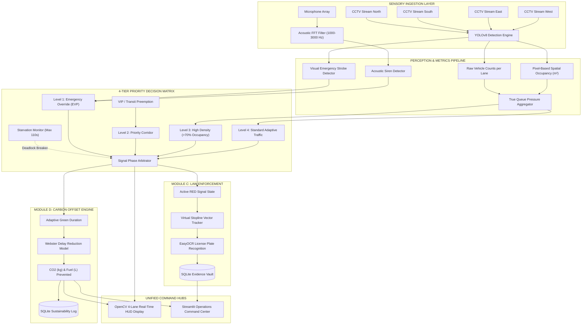

# AI-Powered Adaptive Traffic Control System (ATCS)
### Production-Ready Prototype & Intelligent Urban Infrastructure Framework

[](https://www.python.org/)
[]()
[](https://docs.ultralytics.com/)
[](LICENSE)

---

## 🚦 System Overview & Architectural Paradigm

The **AI-Powered Adaptive Traffic Control System (ATCS)** is an edge-native, real-time cyber-physical traffic signal management platform. It replaces outdated static fixed-time signal controllers (which cause severe congestion, fuel wastage, and transit bottlenecks) with an intelligent, multi-modal autonomous control system.

The system consolidates four mission-critical subsystems:
1. **Module A (Dynamic Adaptive Signal Timing Engine)**: YOLOv8 Computer Vision detecting multi-class traffic (cars, bikes, buses, trucks) paired with **Dual-Metric Density Calculation** (raw counts + pixel-based physical space occupancy in $m^2$).
2. **Module B (Emergency Vehicle Preemption - EVP)**: Multi-modal override system utilizing visual strobe recognition and an acoustic **Fast Fourier Transform (FFT)** filter detecting emergency siren frequencies ($1000\text{ Hz} - 3000\text{ Hz}$) as a fail-safe in dense fog/rain/occlusion.
3. **Module C (Virtual Stopline ANPR & Automated E-Challan Enforcement)**: Automated legal enforcement tracking vehicles crossing stoplines during a RED phase, triggering plate OCR (EasyOCR), and auto-logging violations to an SQLite database (`echallans`).
4. **Module D (Live Carbon Offset & Sustainability Tracking Engine)**: Real-time mathematical modeling calculating avoided idling vehicle-hours, fuel conserved (Liters), urban $\text{CO}_2$ emissions prevented (kg), and equivalent urban tree offsets.
5. **System Decision Matrix**: Strict 4-tier anti-deadlock priority hierarchy (Emergency > VIP > High-Density > Standard) with starvation protection ($T_{\text{wait}} \le 110\text{s}$).
6. **Dual Control Interface**: Multi-pane real-time OpenCV HUD display & Streamlit Operations Command Center.

---

## 🏛️ System Architecture Diagram



---

## 🔬 Mathematical Formulations

### 1. Dual-Metric Spatial Density & Queue Pressure (Module A)
To accurately weigh high-capacity and heavy vehicles (buses and heavy trucks) higher than light personal vehicles, the system computes both discrete vehicle counts and continuous physical road area footprints:

$$\text{Effective Occupancy } (m^2) = \max \left( \sum_{v \in ROI} A_{\text{footprint}, v}, \quad \frac{\text{Pixels}(BBox_v \cap ROI)}{\text{Area}_{ROI\_px}} \times A_{\text{physical\_ROI}} \right)$$

$$\text{Occupancy \%} = \min \left( 100.0, \frac{\text{Effective Occupancy } (m^2)}{A_{\text{physical\_ROI}}} \times 100 \right)$$

True approach queue pressure combining spatial saturation and Passenger Car Units (PCU):

$$\text{Pressure}_L = 0.65 \times \left( \frac{\text{Occupancy \%}_L}{100} \right) + 0.35 \times \left( \frac{\text{PCU}_L}{\max(\text{Total PCU}, 1)} \right)$$

### 2. Adaptive Green Allocation with Anti-Starvation Protection (Decision Matrix)
When transitioning from ALL-RED to GREEN, the target lane receives:

$$T_{\text{green}} = T_{\min} + (T_{\max} - T_{\min}) \times \left( \frac{\text{Pressure}_L}{\sum_j \text{Pressure}_j} \right)$$

- $T_{\min} = 10.0\text{ s}$ (ensures pedestrian crossing safety)
- $T_{\max} = 65.0\text{ s}$ (prevents starvation)
- Anti-starvation condition: If $T_{\text{wait}, i} \ge 110.0\text{ s}$, Lane $i$ immediately preempts cycle selection.

### 3. Fast Fourier Transform (FFT) Siren Spectral Filter (Module B)
Microphone array audio buffers are windowed using a Hann window and processed via real Fast Fourier Transform:

$$X(f) = \sum_{n=0}^{N-1} x[n] \cdot w[n] \cdot e^{-j 2\pi f n / N}$$

$$\text{Power Spectral Density (PSD)}: \quad P(f) = \frac{|X(f)|^2}{N \cdot f_s}$$

$$\text{SNR}_{\text{siren}} = 10 \log_{10} \left( \frac{P(f_{\text{peak}})}{P_{\text{noise\_floor}}} \right) \quad \text{for } f \in [1000\text{ Hz}, 3000\text{ Hz}]$$

Siren detection is confirmed when $\text{SNR} \ge 8.5\text{ dB}$ and spectral peak sharpness $\ge 2.0$.

### 4. Live Carbon & Fuel Emissions Offset Model (Module D)
Avoided delay compared to static baseline signal (Webster's delay reduction model ~25%):

$$\Delta t_{\text{saved}} = \sum_{v \in \text{cleared}} (d_{\text{static}} - d_{\text{adaptive}})$$

$$\text{Fuel Saved (Liters)} = \Delta t_{\text{saved}} \times \left( N_{\text{cars}} r_{\text{car}} + N_{\text{bikes}} r_{\text{bike}} + N_{\text{heavy}} r_{\text{heavy}} \right)$$

- $r_{\text{car}} = 0.000319\text{ L/s}$ (1.15 L/hr idle)
- $r_{\text{bike}} = 0.0000694\text{ L/s}$ (0.25 L/hr idle)
- $r_{\text{heavy}} = 0.000889\text{ L/s}$ (3.20 L/hr idle)
- $\text{CO}_2 \text{ Prevented (kg)} = \text{Fuel Saved (L)} \times 2.42\text{ kg CO}_2/\text{L}$
- $\text{Urban Tree Equivalents} = \frac{\text{CO}_2 \text{ Prevented (kg)}}{21.77\text{ kg/tree-year}}$

---

## 🚀 Execution Guide

### Option 1: Interactive Quick Launcher
```bash
python run_demo.py
```
Presents a selection menu to launch HUD, Streamlit, or the automated test suite.

### Option 2: Live OpenCV 4-Lane Real-Time HUD Display
```bash
python atcs_system.py --mode hud
```
**Interactive Keyboard Hotkeys in HUD Window:**
- `A` : Dispatch Ambulance into North Approach (triggers Level 1 Visual EVP)
- `S` : Inject 1.8 kHz Acoustic Siren audio burst (triggers Level 1 Acoustic EVP)
- `R` : Force vehicle red-light breach (triggers Module C Stopline ANPR & E-Challan)
- `Q` or `ESC` : Graceful exit

### Option 3: Streamlit Operations & Analytics Command Center
```bash
streamlit run ui/streamlit_app.py
```
Access the dashboard at `http://localhost:8501`. Features live feeds, EVP override buttons, acoustic FFT spectrogram visualizer, and e-challan legal registry.

### Option 4: Automated Verification Test Suite
```bash
python -m unittest test_atcs.py -v
```

---

## 🗄️ Database Schema (`atcs_traffic.db`)

1. **`echallans`**: `id`, `timestamp`, `lane_id`, `vehicle_type`, `license_plate`, `confidence`, `image_path`, `violation_type`, `fine_amount`, `status`.
2. **`traffic_telemetry`**: `id`, `timestamp`, `lane_id`, `vehicle_count`, `spatial_occupancy_m2`, `occupancy_percent`, `pcu_count`, `signal_state`, `allocated_green_s`, `priority_level`.
3. **`sustainability_log`**: `id`, `timestamp`, `cycle_id`, `avoided_delay_seconds`, `fuel_saved_liters`, `co2_prevented_kg`, `monetary_savings_usd`.
